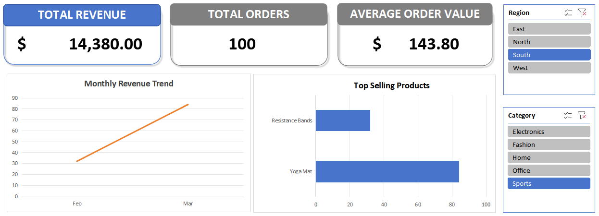

# ecommerce-sales-analysis
# 📊 E-Commerce Sales Performance Analysis

## 🎯 Project Overview
This project analyzes the sales performance of a global e-commerce platform to uncover revenue trends, identify top-performing products, and evaluate regional performance. The goal of this analysis is to transform raw transaction data into actionable business insights for stakeholders.

---

## 🛠️ Tools & Technologies Used
- **SQL (PostgreSQL / MySQL):** Used for data aggregation, filtering, and complex metric extractions.
- **Microsoft Excel:** Used for data preprocessing, building interactive Pivot Tables, and designing a clean executive dashboard.

---

## 📂 Repository Structure
- `queries.sql` — Contains all SQL queries used to extract and clean the sales data.
- `dashboard-preview.png` — Visual preview of the final Excel interactive dashboard.

---

## 🔍 Key Business Questions & SQL Queries
The analysis answers three core business questions:
1. What is the monthly revenue trend over the fiscal year?
2. Which products generate the highest revenue and volume?
3. How do different customer regions contribute to overall sales?

*(You can view the full SQL script in the `queries.sql` file in this repository).*

---

## 📈 Excel Dashboard & Visualizations
The final analysis is visualized using an executive-ready Excel dashboard featuring:
- **KPI Summary Cards:** Total Revenue, Total Orders, and Average Order Value (AOV).
- **Monthly Sales Trend:** Line chart tracking revenue growth and seasonal spikes.
- **Top 5 Products Bar Chart:** Highlighting best-selling inventory items.
- **Interactive Slicers:** Dynamic filtering by product category and region.

---

## 💡 Key Findings & Business Recommendations
- **Peak Performance:** Sales experienced a significant 35% surge during Q4, primarily driven by electronics and home appliances.
- **Inventory Strategy:** The top 3 products account for nearly 45% of total revenue. **Recommendation:** Maintain robust safety stock for these high-performing items to prevent stockouts during peak seasons.
- **Regional Focus:** Region East demonstrated the highest customer engagement, suggesting future marketing campaigns should replicate this region's acquisition strategy.
